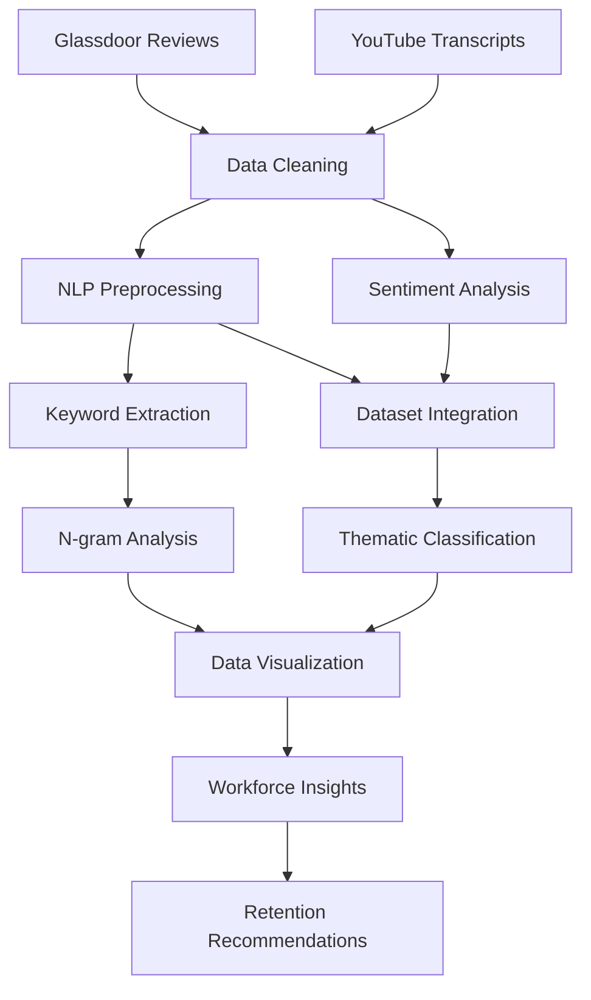

<<<<<<< HEAD
# 📊 Workforce Sentiment Analysis | Amazon Fulfillment Centers
=======
# 📊 Amazon Fulfillment Centers – Workforce Analytics
>>>>>>> c32e3f2882ab0cc5aeafb008242b55a86ec83879

Transforming unstructured workforce feedback into actionable
business insights through natural language processing,
sentiment analysis, and data visualization.


---

## 👨‍💻 About My Role

**Data Analytics Extern | Amazon Fulfillment Centers**

**May 2026 – June 2026**

During my externship, I combined my interests in computer
science and business to investigate potential workforce
attrition drivers at Amazon Fulfillment Centers.

I developed Python-based analytical programs to process
employee feedback from Glassdoor and YouTube, identify
recurring workplace concerns, and translate analytical
findings into actionable employee retention strategies.

This project allowed me to apply programming, natural
language processing, and data analytics to real-world
business challenges.

---

## 💡 Inspiration

Employee feedback provides valuable insights into workplace
conditions, employee satisfaction, and organizational
challenges.

However, manually analyzing large amounts of unstructured
feedback can be inefficient and make recurring patterns
difficult to identify.

The objective of this project was to use computational
techniques to extract meaningful insights from workforce
feedback and develop data-driven recommendations that
could support employee retention.

---

## 🚀 What It Does

The project implements an end-to-end workforce analytics
pipeline that supports:

- Automated data cleaning and preprocessing
- Missing value and duplicate removal
- Natural language processing (NLP)
- Sentiment polarity and subjectivity analysis
- Positive, neutral, and negative sentiment classification
- Keyword frequency extraction
- Unigram, bigram, and trigram analysis
- Cross-platform dataset integration
- Rule-based thematic classification
- Automated data visualization and report generation

---

## 📈 Key Accomplishments

| Metric | Accomplishment |
|---|---|
| 141 | Recovered Glassdoor dataset rows processed |
| 132 | Cleaned records retained |
| 28 | Original dataset fields |
| 93.6% | Data retention rate in the recovered dataset run |
| 2 | Data platforms analyzed during the externship |
| 5 | Workforce themes investigated |
| 2 | Employee retention strategies proposed |
| 6 | Automated tests passed in the portfolio refactor |

---

## ⚙️ How It Works

1. Import workforce feedback from CSV datasets.
2. Remove incomplete, redundant, and unnecessary data.
3. Preprocess unstructured text using NLTK.
4. Calculate sentiment polarity and subjectivity using TextBlob.
5. Extract frequently occurring words and phrases.
6. Integrate datasets into a standardized format.
7. Classify feedback into predefined workforce themes.
8. Generate visualizations and analytical reports.
9. Translate findings into employee retention recommendations.

---

## 🧠 Analysis Pipeline



---

## 🔍 Workforce Themes

The thematic classification system investigates five
key workforce themes:

### 1. Physical Exhaustion and Burnout

Physical demands, repetitive movements, fatigue, and
workplace exhaustion.

### 2. Productivity Targets and Micromanagement

Productivity expectations, performance monitoring,
workplace pressure, and employee autonomy.

### 3. Feeling Replaceable and Undervalued

Employee recognition, managerial support, workplace
morale, and feelings of appreciation.

### 4. Pay and Benefits

Compensation, wages, insurance, financial incentives,
and employee benefits.

### 5. Scheduling and Work-Life Balance

Shift flexibility, overtime, scheduling, rest periods,
and work-life balance.

---

## 📊 Sentiment Analysis

TextBlob is used to calculate sentiment polarity and
subjectivity scores for workforce feedback.

| Polarity Score | Classification |
|---|---|
| Greater than 0.1 | Positive |
| -0.1 to 0.1 | Neutral |
| Less than -0.1 | Negative |

The pipeline generates:

- Sentiment distribution bar charts
- Sentiment breakdown pie charts
- Keyword frequency charts
- Bigram frequency charts
- Trigram frequency charts
- Word clouds
- Workforce theme frequency tables
- Cross-platform sentiment comparisons

---

## 🛠️ Tech Stack

| Category | Technologies |
|---|---|
| Programming | Python |
| Data Processing | pandas |
| Natural Language Processing | NLTK, TextBlob |
| Feature Extraction | Tokenization, N-grams, Keyword Extraction |
| Classification | Rule-Based Multi-Label Classification |
| Data Visualization | Matplotlib, WordCloud |
| Automated Testing | pytest |
| Development | Google Colab, Jupyter Notebook |
| Version Control | Git, GitHub |

---

## ⚠️ Technical Challenges

- Processing inconsistent and unstructured text data.
- Handling missing values and duplicate records.
- Standardizing data from multiple platforms.
- Extracting meaningful keywords while filtering noise.
- Designing keyword dictionaries for thematic classification.
- Interpreting sentiment within workplace contexts.
- Translating analytical findings into practical business
  recommendations.

---

## 🏅 Business Impact

Based on my analytical findings, I developed two actionable
employee retention recommendations.

### Structured Supervisor Check-ins

Proposed regular supervisor-employee check-ins to strengthen
managerial support, identify workplace concerns, and improve
communication.

### Employee Feedback Mechanisms

Proposed structured feedback mechanisms to provide employees
with opportunities to communicate workplace concerns and
receive recognition.

These recommendations were submitted to Amazon for evaluation.

---

## 📚 What I Learned

Throughout this externship, I gained practical experience in:

- Python programming and real-world data processing
- Natural language processing
- Sentiment analysis
- Data preprocessing and feature extraction
- Exploratory data analysis
- Multi-source data integration
- Rule-based text classification
- Data visualization
- Translating technical findings into business strategies

This experience strengthened my interest in combining
computer science and business to develop technology-driven
solutions that create meaningful real-world impact.

---

## 📁 Repository Structure

```text
workforce-sentiment-analysis/
│
├── main.py
├── README.md
├── requirements.txt
├── requirements-dev.txt
├── .gitignore
│
├── src/
│   ├── __init__.py
│   ├── cleaning.py
│   ├── sentiment.py
│   ├── keywords.py
│   ├── themes.py
│   └── visualization.py
│
├── data/
│   ├── glassdoor_sample.csv
│   └── youtube_sample.csv
│
└── tests/
    └── test_pipeline.py
```

---

## 🧪 Getting Started

### Prerequisites

- Python 3.10 or higher
- pip

### 1. Create a Virtual Environment

```bash
python3 -m venv .venv
source .venv/bin/activate
```

### 2. Install Dependencies

```bash
pip install -r requirements.txt
```

### 3. Download NLTK Resources

```bash
python -m nltk.downloader stopwords
```

### 4. Run the Demonstration

```bash
python main.py --glassdoor data/glassdoor_sample.csv --youtube data/youtube_sample.csv
```

### 5. Run With Original Data

If you have authorized access to the original dataset,
place it inside the private_data directory.

```bash
python main.py --glassdoor private_data/glass_reviews_completed.csv --output outputs/recovered
```

### 6. Run Without Downloading NLTK Resources

```bash
python main.py --glassdoor data/glassdoor_sample.csv --offline-stopwords
```

### 7. Run Automated Tests

```bash
pip install -r requirements-dev.txt
python -m pytest -q
```

Generated visualizations and analytical results are saved
in the outputs directory.

---

## 🔮 Future Development

- [ ] Transformer-based sentiment analysis using BERT
- [ ] Machine learning-based thematic classification
- [ ] Automated topic modeling
- [ ] Interactive workforce analytics dashboard
- [ ] Employee cohort analysis
- [ ] Sentiment model accuracy evaluation
- [ ] Expanded data integration
- [ ] Automated analytical report generation enhancements

---

## 📌 Portfolio Improvements

Following the original externship, this project was
refactored into a modular Python application to improve
code organization, maintainability, and reproducibility.

Additional improvements include:

- Reusable Python modules
- Automated end-to-end pipeline execution
- Command-line arguments
- Improved keyword and phrase matching
- Automated visualization generation
- Synthetic demonstration datasets
- Six automated unit and integration tests

These improvements represent subsequent portfolio
development rather than original externship deliverables.

---

## 🔒 Data Privacy and Limitations

The public repository uses synthetic demonstration datasets
to protect employee privacy and project confidentiality.

Sentiment scores and keyword-based classifications are
heuristic estimates. They identify recurring patterns but
do not establish causal relationships between workplace
conditions and employee attrition.

This project is an independent portfolio demonstration
of my technical contributions and is not an official
Amazon software product.

---

## 👨‍💻 About Me

**Mio Pairotkijja**

University of British Columbia (UBC)

Combined Major in Business and Computer Science (BUCS)

I am a second-year student passionate about software
engineering, artificial intelligence, game development,
and building technology-driven solutions to real-world
problems.

My interests lie at the intersection of computer science
and business, where I can apply technical skills to create
meaningful and practical solutions.

---