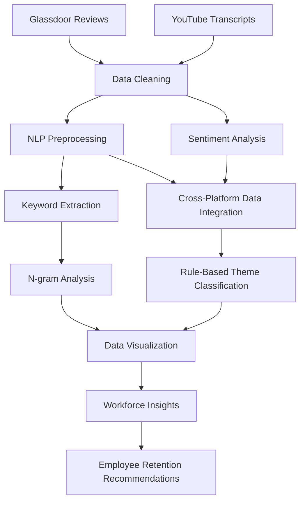

# 📊 Amazon Fulfillment Centers – Workforce Analytics

A data analytics and Natural Language Processing (NLP) project
exploring potential workforce attrition drivers at Amazon
Fulfillment Centers through employee feedback, sentiment analysis,
and thematic classification.

Developed during my Data Analytics Externship from May to June 2026.


---

## 👨‍💻 About My Role

**Role:** Data Analytics Extern

**Organization:** Amazon Fulfillment Centers – Industry Project

**Duration:** May 2026 – June 2026

**Developer:** Mio Pairotkijja

Throughout this externship, I applied my interests in computer
science, business, and data analytics to investigate workforce
challenges and develop data-driven employee retention strategies.

I developed Python-based programs to process unstructured employee
feedback, extract meaningful patterns, and translate analytical
findings into actionable business recommendations.

---

## 💡 Inspiration

Employee feedback contains valuable insights into workplace
conditions, managerial support, employee satisfaction,
and workforce retention.

However, manually reviewing large amounts of unstructured
feedback can be time-consuming and make recurring patterns
difficult to identify.

This project explores how programming, natural language
processing, and data visualization can transform unstructured
feedback into meaningful insights that support business
decision-making.

---

## 🚀 What It Does

The project analyzes workforce feedback collected from
Glassdoor reviews and YouTube transcripts.

The analytical pipeline performs:

- Data cleaning and preprocessing
- Missing value and duplicate removal
- Natural language processing
- Sentiment polarity and subjectivity analysis
- Keyword frequency extraction
- Unigram, bigram, and trigram analysis
- Rule-based thematic classification
- Cross-platform dataset integration
- Data visualization

These techniques help identify recurring workforce concerns
and potential employee attrition drivers.

---

## 📈 Key Accomplishments

| Metric | Accomplishment |
|---|---|
| 150+ | Employee reviews analyzed |
| 2 | Data sources integrated |
| 3 | Levels of n-gram analysis |
| 5 | Workforce themes investigated |
| 2 | Employee retention strategies proposed |

---

## ⚙️ How It Works

1. Collect structured review data and video transcripts.
2. Clean datasets by removing missing values, duplicates,
   punctuation, and unnecessary information.
3. Apply NLP techniques to preprocess unstructured text.
4. Calculate sentiment polarity and subjectivity using TextBlob.
5. Extract frequently occurring keywords and phrases.
6. Integrate Glassdoor and YouTube sentiment datasets.
7. Classify feedback into predefined workforce themes.
8. Visualize analytical findings and identify recurring patterns.
9. Develop actionable employee retention recommendations.

---

## 🧠 System Architecture



---

## 🔍 Technical Implementation

### Data Cleaning and Preprocessing

Developed Python programs using pandas and NLTK to prepare
unstructured feedback for analysis.

- Removed duplicate records
- Handled missing values
- Filtered unnecessary dataset columns
- Normalized text
- Removed punctuation and stopwords
- Combined multiple review fields

### Sentiment Analysis

Implemented TextBlob to calculate sentiment polarity and
subjectivity scores.

Feedback was classified using the following thresholds:

| Polarity Score | Classification |
|---|---|
| Greater than 0.1 | Positive |
| Between -0.1 and 0.1 | Neutral |
| Less than -0.1 | Negative |

Sentiment distributions were compared across Glassdoor
and YouTube datasets.

### Keyword Extraction and N-gram Analysis

Used NLTK and Python's Counter to identify frequently
occurring words and phrases.

- Unigrams: individual words
- Bigrams: sequences of two words
- Trigrams: sequences of three words

These techniques helped identify recurring topics and
patterns within employee feedback.

### Rule-Based Thematic Classification

Developed a keyword-based classification system to categorize
feedback across five workforce themes:

1. Physical Exhaustion and Burnout
2. Pressure from Productivity Targets and Micromanagement
3. Feeling Replaceable and Undervalued
4. Pay and Benefits as a Key Motivation
5. Mixed Views on Scheduling and Work-Life Balance

Individual feedback records can be associated with
multiple themes.

### Cross-Platform Data Integration

Combined Glassdoor reviews and YouTube transcripts into
a standardized dataset containing:

- Cleaned text
- Sentiment polarity
- Sentiment subjectivity
- Sentiment classification
- Source platform
- Workforce theme classifications

### Data Visualization

Used Matplotlib and WordCloud to communicate analytical
findings through:

- Sentiment distribution bar charts
- Sentiment breakdown pie charts
- Keyword frequency charts
- Bigram and trigram visualizations
- Word clouds

---

## 🛠️ Tech Stack

| Category | Technologies |
|---|---|
| Programming | Python |
| Data Processing | pandas |
| Natural Language Processing | NLTK, TextBlob |
| Feature Extraction | Tokenization, N-grams, Keyword Frequency |
| Classification | Rule-Based Classification |
| Data Visualization | Matplotlib, WordCloud |
| Development Environment | Jupyter Notebook, Google Colab |
| Version Control | Git, GitHub |

---

## 📁 Repository Structure

```text
workforce-sentiment-analysis/
│
├── src/
│   ├── cleaning.py
│   ├── sentiment.py
│   ├── keywords.py
│   ├── themes.py
│   ├── visualization.py
│   └── __init__.py
│
├── data/
│   ├── glassdoor_sample.csv
│   └── youtube_sample.csv
│
├── tests/
│   └── test_pipeline.py
│
├── main.py
├── requirements.txt
├── requirements-dev.txt
├── .gitignore
└── README.md
```

---

## ⚠️ Technical Challenges

- Processing inconsistent and unstructured text data.
- Handling missing values and duplicate records.
- Standardizing datasets from different platforms.
- Identifying meaningful keywords while filtering noise.
- Designing keyword dictionaries for thematic classification.
- Interpreting sentiment scores within workplace contexts.
- Translating technical findings into practical business
  recommendations.

---

## 🏅 Business Impact

Based on the analytical findings, I developed two employee
retention recommendations focused on:

### Structured Supervisor Check-ins

Encouraging regular communication between supervisors and
employees to identify workplace concerns and strengthen
managerial support.

### Employee Feedback Mechanisms

Creating structured opportunities for employees to communicate
concerns, receive recognition, and provide feedback about
workplace conditions.

These recommendations were submitted to Amazon for evaluation.

---

## 📚 What I Learned

Through this externship, I gained practical experience in:

- Python programming for real-world data processing
- Natural language processing
- Sentiment analysis and text classification
- Data cleaning and feature extraction
- Integrating multiple data sources
- Exploratory data analysis
- Data visualization and communication
- Translating technical insights into business strategies
- Applying computer science to real-world business challenges

This experience strengthened my interest in combining
computer science and business to develop technology-driven
solutions with meaningful organizational impact.

---

## 🔮 Future Development

Potential improvements to this project include:

- [ ] Transformer-based sentiment analysis using BERT
- [ ] Machine learning-based thematic classification
- [ ] Automated topic modeling
- [ ] Interactive analytics dashboard
- [ ] Improved sentiment classification accuracy
- [ ] Evaluation against manually labeled feedback
- [ ] Expanded cross-platform data analysis

---

## 🧪 Getting Started

### Prerequisites

- Python 3.10+
- pip

### Installation

Clone the repository and navigate into the project directory.

Create a virtual environment:

```bash
python3 -m venv .venv
source .venv/bin/activate
```

Install the required dependencies:

```bash
pip install -r requirements.txt
```

Download the required NLTK resources:

```bash
python -m nltk.downloader stopwords
```

Run the analytical pipeline using the provided sample datasets:

```bash
python main.py --glassdoor data/glassdoor_sample.csv --youtube data/youtube_sample.csv
```

### Running Tests

```bash
pip install -r requirements-dev.txt
python -m pytest -q
```

---

## 📌 Methodology and Limitations

Sentiment scores and keyword-based theme classifications
are heuristic estimates rather than validated predictions.

The analysis identifies recurring patterns and potential
workforce concerns but does not establish causal relationships
between employee feedback and workforce attrition.

The repository is a modular portfolio refactor of my original
externship notebooks, with additional improvements to code
organization, reproducibility, and testing.

---

## 🔒 Data Privacy

To protect employee privacy and project confidentiality,
this repository contains synthetic sample datasets rather
than the original employee reviews or transcripts.

This repository is an independent portfolio demonstration
of my technical contributions and is not an official
Amazon software product.

---

## 👨‍💻 Author

**Mio Pairotkijja**

University of British Columbia

Combined Major in Business and Computer Science (BUCS)

Passionate about software engineering, artificial intelligence,
game development, and building technology-driven solutions
that create real-world impact.

---

**Turning unstructured data into actionable insights.**
=======
# Amazon-Fulfillment-Centers-Externship-Files
>>>>>>> b507e3fa53b609bf30ecca31c9e8e1ee58a34b9a
